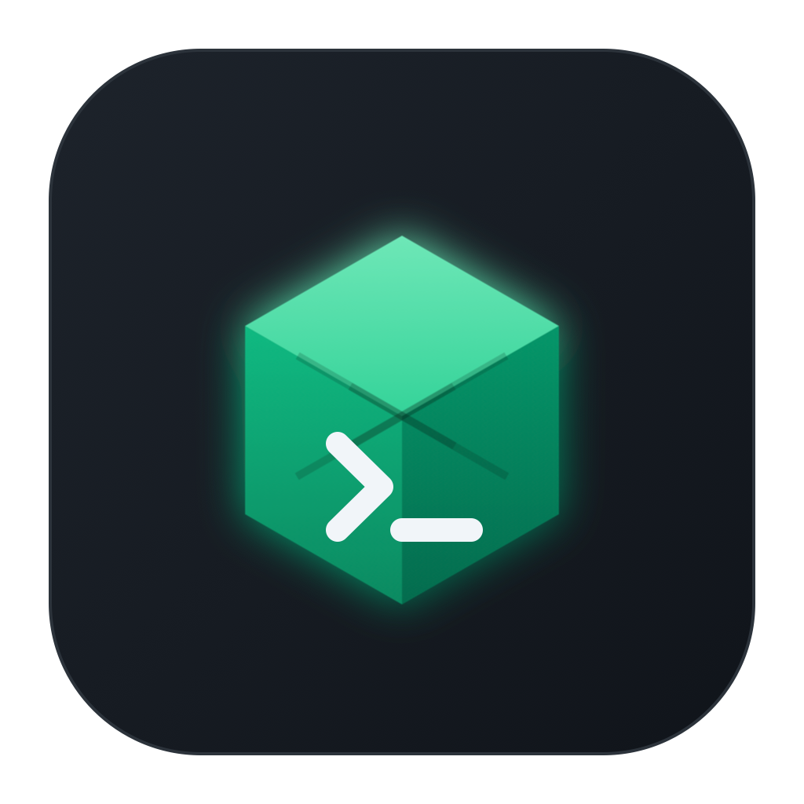

<div align="center">



# Naveo

**Conteneurs + Kubernetes, une seule app native en Rust.**

[](https://github.com/crabearaignee/Naveo/actions/workflows/ci.yml)
[](https://github.com/crabearaignee/Naveo/releases)
[](LICENSE)


</div>

---

Naveo est une application desktop **100 % Rust** (pas d'Electron, pas de navigateur embarqué) qui réunit dans une même fenêtre :

- la **gestion des conteneurs Docker** (conteneurs, images, volumes, réseaux, logs),
- la **vision Kubernetes** (nœuds, pods, déploiements, logs de pods, multi-cluster).

## Fonctionnalités (v0.1.0 — MVP)

### Docker
- ✅ Conteneurs groupés par projet Compose, avec statut, ports et actions (démarrer ⏵, arrêter ⏹, logs 📜, supprimer 🗑)
- ✅ Images : liste, taille, âge, suppression
- ✅ Volumes et réseaux
- ✅ Logs des conteneurs (500 dernières lignes)
- ✅ Auto-rafraîchissement toutes les 5 s + recherche globale

### Kubernetes
- ✅ **Multi-cluster** : détection automatique de tous les kubeconfigs de `~/.kube/` et de `$KUBECONFIG`, sélecteur de cluster dans la barre du haut, import de kubeconfig 📁
- ✅ Nœuds : état Ready, version kubelet, IP, rôles, ressources allocables
- ✅ Pods : namespace, phase, redémarrages, conteneurs, logs, suppression
- ✅ Déploiements : réplicas prêts/souhaités, image
- ✅ **Terminal** : `sh -c <cmd>` dans un conteneur ou un pod

### Interface
- ✅ UI native Rust ([egui](https://github.com/emilk/egui)) : fenêtre légère, démarrage instantané
- ✅ Thème sombre / clair, cartes arrondies, points de statut colorés
- ✅ Backend asynchrone (tokio) découplé de l'UI via canaux — l'interface ne se fige jamais

## Architecture

```
crates/
├── naveo-core/          # Backend : clients Docker (bollard) + Kubernetes (kube-rs)
│   └── src/
│       ├── docker.rs    # Listes, actions, logs Docker
│       ├── k8s.rs       # Nœuds, pods, déploiements, logs K8s
│       └── events.rs    # Command (UI → backend) et Event (backend → UI)
└── naveo/               # App graphique (egui/eframe)
    └── src/
        ├── app.rs       # État global, sidebar, barre du haut, boucle egui
        ├── theme.rs     # Palette Naveo (sombre/clair), cartes, statuts
        └── views/       # Une vue par page : conteneurs, images, volumes,
                         # réseaux, nœuds, pods, déploiements, journal, paramètres
```

```
UI egui ──► Command (mpsc tokio) ──► tâche de fond (naveo-core)
   ▲                                     │  bollard / kube-rs
   └──── Event (crossbeam channel) ◄─────┘  Docker socket / API K8s
```

## Télécharger

Binaires précompilés (macOS Apple Silicon/Intel, Linux x64/arm64, Windows x64)
dans les [GitHub Releases](https://github.com/crabearaignee/Naveo/releases) —
publiés automatiquement à chaque tag `v*`.

## Build & lancement

Prérequis : [Rust](https://rustup.rs) (stable).

```sh
cargo run --release          # lance l'app
cargo build --release        # binaire : target/release/naveo
```

L'app se connecte automatiquement à :
- **Docker** : socket local (`/var/run/docker.sock`, Docker Desktop…)
- **Kubernetes** : contexte par défaut de `~/.kube/config` (ou `$KUBECONFIG`)

Si Docker ou Kubernetes ne sont pas disponibles, l'app se lance quand même
et affiche l'état des connexions ; les pages concernées restent désactivées.

## Feuille de route

- [x] ~~Terminal : exécution de commandes dans conteneurs et pods~~
- [x] ~~Multi-cluster : sélecteur de contexte + import de kubeconfig~~
- [x] ~~Suivi des logs en continu (follow)~~
- [x] ~~Détail conteneur : stats live (CPU/mémoire/réseau) + inspect JSON~~
- [x] ~~Docker : pause/reprise/kill + actions sur tout un projet Compose~~
- [x] ~~Kubernetes : drill-down par conteneur des pods, logs précédents (crash), filtre de namespace, Services~~
- [x] ~~Docker Hub : pull d'image, recherche et tags, exécution avec env/ports~~
- [x] ~~Actions en masse (multi-sélection) + prune conteneurs/images/volumes/réseaux~~
- [x] ~~Gestion d'images : tag, export/import tar, historique des couches, registries~~
- [x] ~~Explorateur de fichiers du conteneur (liste, aperçu, sauvegarde)~~
- [x] ~~Édition à chaud : rename, commit, export, env/ports (recréation)~~
- [x] ~~Logs enrichis : filtre par niveau, timestamps, tail, téléchargement~~
- [x] ~~Terminal : historique des commandes (↑↓)~~
- [x] ~~Kubernetes : vue Événements, scale + rollout restart des déploiements~~
- [x] ~~Kubernetes : port-forward local → pod, ConfigMaps / Secrets / Ingress / PVC~~
- [x] ~~Préférences persistées (thème), thème système, tri de colonnes, copier au presse-papier~~
- [ ] Terminal interactif (session PTY persistante)
- [ ] Éditeur YAML avec application des changements
- [ ] RBAC-aware : masquer les actions non permises
- [ ] Machines Linux
- [ ] Plugins (WebAssembly ?)

## Crédits

- [Headlamp](https://github.com/kubernetes-sigs/headlamp) — structure des vues Kubernetes
- [bollard](https://github.com/fussybeaver/bollard), [kube-rs](https://github.com/kube-rs/kube), [egui](https://github.com/emilk/egui)

## Licence

Apache-2.0 — voir [LICENSE](LICENSE).
